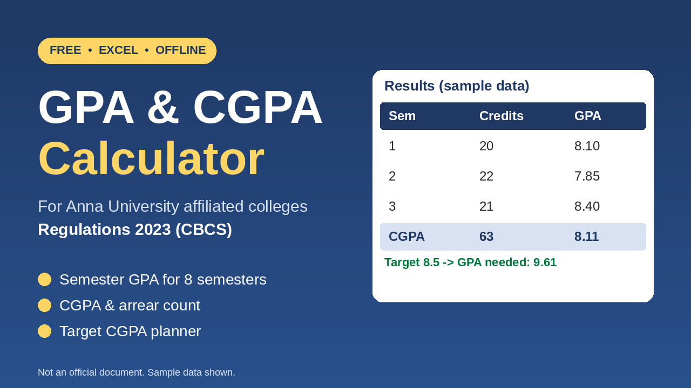

# GPA & CGPA Calculator (Anna University Affiliated Colleges, Regulations 2023)

A free Excel workbook that calculates semester GPA, CGPA and arrear count, and shows the GPA you need next semester to reach a target CGPA.

Built as a practice project in Excel formulas, data validation and sheet protection.

## Features

- GPA for each of 8 semesters
- CGPA and arrear (RA/SA/W) count
- Target planner: the GPA needed next semester for your target CGPA
- Grade dropdown (O, A+, A, B+, B, RA, SA, W)
- Editable grade scale and a setting for counting failed courses in GPA
- Works offline in Microsoft Excel

## Download

[Download the Excel file](https://docs.google.com/spreadsheets/d/1_eFdHos9euVF7UE0uFo7UrHesqYQJQLa/edit?usp=drivesdk&ouid=115042175686906564419&rtpof=true&sd=true)

Open it in **Microsoft Excel**. The sheet protection (which stops accidental edits to formulas) does not work in Google Sheets.

## How to use

1. Open the **Courses** sheet.
2. Delete the sample rows (yellow cells) and enter your own: semester, course code, course name, credits, grade.
3. See results on the **Summary** sheet.
4. Use **Target Planner** to set your target CGPA and next semester's credits.

Enter 0-credit courses (for example, Heritage of Tamil) too. They do not affect GPA.

## Sheets

| Sheet | Purpose |
|---|---|
| Start Here | Instructions and notes |
| Grade Scale | Grade points and the failed-course setting (editable) |
| Courses | Your course entries (up to 200 rows) |
| Summary | Semester GPA, CGPA, arrears, approximate percentage |
| Target Planner | GPA needed next semester for a target CGPA |

## How it calculates

- Grade point comes from the Grade Scale sheet.
- Credit points = credits x grade point.
- GPA = total credit points / total credits for the semester.
- CGPA = total credit points / total credits across all semesters.
- Percentage shown is CGPA x 10, an approximation only.

## Verification status

- Checked against official grade sheets for **Regulations 2023 (CBCS)**, **semesters 1-3**, for the grades O, A+, A and B+. Results matched.
- **Not yet verified:** the B grade, and arrear cases (RA/SA/W). The setting for whether failed courses count in GPA defaults to "No" and is an assumption.
- Other regulations or colleges may use different rules. Check the Grade Scale sheet before relying on the results.

**This is not an official document. Always confirm results with your official grade sheet.**

## Found a mismatch?

Please open an issue with the semester, courses, credits, grades, the value you expected and the value the workbook shows. Do not post personal details such as your register number.

## Tools

Microsoft Excel (formulas, data validation, conditional formatting, sheet protection).

## Author

Mukesh, B.Tech Artificial Intelligence and Data Science student.
